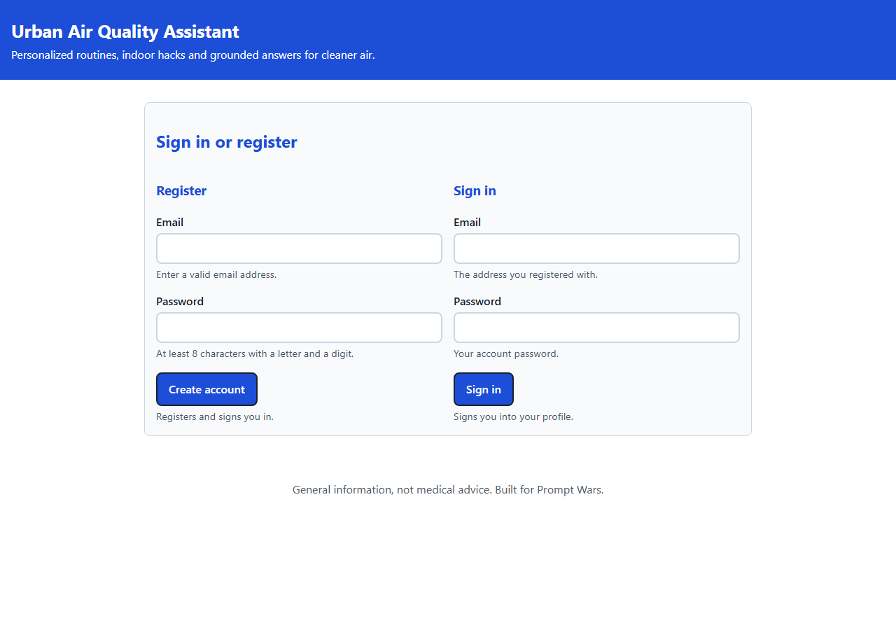
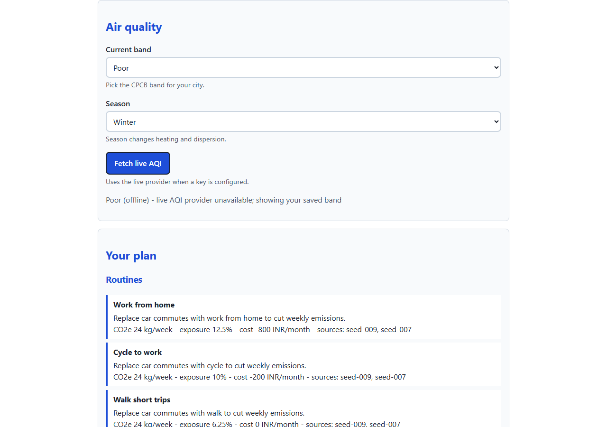
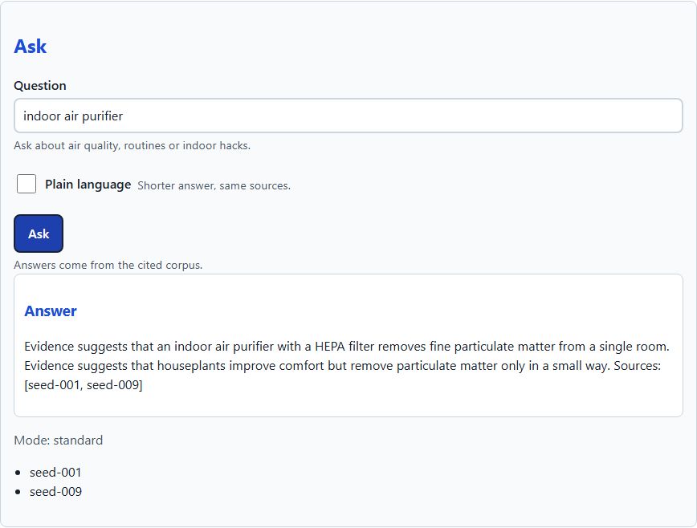

# Urban Air Quality Assistant

FastAPI + vanilla-JS assistant that turns a user's city, household and
lifestyle profile plus CPCB AQI context into personalized low-emission
routines, indoor air hacks, sustainable alternatives, quantified impact and
grounded cited answers.

> Disclaimer: This guidance is general information, not medical advice.

## Architecture

The backend is layered. `backend/app/routes/` holds thin HTTP adapters that
depend on domain modules (`backend/app/profile.py`, `backend/app/aqi.py`,
`backend/app/impact.py`, `backend/app/plans.py`, `backend/app/prompting.py`,
`backend/app/retrieval.py`, `backend/app/auth/`, `backend/app/air/`), which in
turn depend on the repository port in `backend/app/storage/protocol.py`. Both
the SQLite store and the in-memory test double implement that port, so the
storage backend is substitutable (dependency inversion).

Integrations sit behind provider ports: `backend/app/llm/factory.py` selects
Gemini, an OpenAI-compatible endpoint, or the deterministic local composer, and
`backend/app/air/provider.py` abstracts the live AQI adapter. Remote providers
use the standard library's HTTP client (no vendor SDK packages) and fall back
to local synthesis on timeout, redirect, oversized response or a malformed
response, so `/ask` never 500s.
Offline local synthesis is the default; remote keys are optional. The frontend
is static HTML/CSS/JS served by FastAPI and calls the JSON API with a bearer
token.

## Quickstart

The app requires **Python 3.11 or newer** (developed and tested on 3.11.9). On
Windows the default `python` may still be 3.10, so create the environment with
the versioned launcher:

```bat
py -3.11 -m venv .venv
.venv\Scripts\activate
pip install -r requirements.txt
copy .env.example .env
uvicorn backend.app.main:app --reload --port 8000 --no-proxy-headers
```

In PowerShell, use `Copy-Item .env.example .env` instead of `copy`. On macOS or
Linux, create the environment with `python3.11 -m venv .venv`, activate it with
`source .venv/bin/activate`, install the requirements, and copy the template
with `cp .env.example .env`. Importing `backend/app/main.py` on an older
interpreter fails immediately with an explicit version message instead of an
opaque dependency import error.

Then open http://localhost:8000. `--no-proxy-headers` stops Uvicorn from
rewriting the client address from `X-Forwarded-For`, so `TRUST_PROXY` remains
the only switch for proxy-aware rate limiting; keep the flag on every launch
command.

## Performance and resource bounds

Measured on the Windows development host by `scripts/benchmark.py` (30 passes
against a real Uvicorn server; full methodology and machine details in
`docs/BENCHMARKS.md`, raw numbers in `docs/benchmark-results.json`):

- Grounded `/ask` p50 17.8 ms, p95 22.9 ms; refusal p50 15.0 ms, p95 29.5 ms.
- `GET /air` offline p50 17.0 ms, p95 26.5 ms.
- ~1 MB PDF upload p50 306 ms, p95 340 ms; inline document insert p50 16.1 ms.
- Register + login p50 450 ms: PBKDF2 at 600,000 iterations runs twice, by design.
- Cold import median 2.19 s; Docker image 171.5 MiB, 512 MiB container smoke passed.

The efficiency tests keep hard ceilings: a 50-request sample of `GET /health`
and a cached corpus search measures health p50 2.7 ms / p95 3.8 ms and cached
search p50 0.6 ms / p95 0.8 ms, both asserted against a 1.0 s bound. Repeat
searches hit the TF-IDF cache (54 hits / 1 miss in the sample, > 95%).
Coverage gate: total line coverage >= 76% (`TOTAL >= 76%`), currently 92%.
- Retrieval relevance: a hit grounds a question only when its TF-IDF cosine is
  at least `0.15` **and** at least `30%` of the query's content tokens appear
  in the hit's text/title. Content tokens exclude stop words and generic filler
  ("best", "top", ...), and light normalization maps "children" -> "child",
  "smoggy" -> "smog" and plurals to singular. An out-of-domain question with no
  content-token match is refused with `grounded: false` and no citations.
- Every backend module stays under 150 lines (enforced by a test).
- Upload cap: 5 MiB (`MAX_UPLOAD_BYTES`); documents per owner: 10
  (`MAX_DOCUMENTS`). Ordinary request bodies are capped at 1 MiB; the upload
  route gets the 5 MiB cap plus 1 MiB of multipart headroom. Uploads are
  parsed one at a time, and a concurrent upload returns 503 with
  `Retry-After: 2` instead of queueing, keeping peak memory inside the
  512 MB free tier.
- Document text cap: 50,000 characters (`MAX_DOCUMENT_CHARS`) after
  sanitization, applied to manual text and extracted PDF text alike; longer
  input returns 422 instead of being silently truncated. Empty or
  whitespace-only text (including a PDF with no extractable text) returns
  422 with `document text must not be empty`.
- Rate limit: 200 requests/minute per client (`RATE_LIMIT_PER_MIN`), at most
  10,000 buckets (`MAX_RATE_BUCKETS`). `/health` is exempt so probes cannot
  exhaust a user's budget. Set `TRUST_PROXY=true` behind a trusted reverse
  proxy to bucket on the proxy-appended rightmost `X-Forwarded-For` hop;
  `TRUSTED_PROXY_HOPS` (default `1`) selects the Nth hop from the right and
  caller-supplied leftmost entries are ignored.

## Tests

Test suite: **391 tests** collected by `pytest --collect-only`; the quality
gate requires at least 200.

```bash
python -m pytest -q              # run the suite
python scripts/check_quality.py  # ruff + mypy + pytest + coverage gate
```

Browser end-to-end and accessibility tests use Playwright 1.65.1 and
axe-core 4.14.0 (pinned in `e2e/package.json`). They start their own Uvicorn
on port 8901 with a fresh temporary database and the offline providers, so the
run needs no network:

```bash
cd e2e
npm ci
npx playwright install chromium
npm test
```

The journey spec covers registration, profile save, offline AQI, grounded and
refused answers, PDF upload, sign-out and sign-in. The axe spec audits the
home/login, register, dashboard, documents and profile states. See
`docs/EVIDENCE.md` for the recorded results and screenshots.

## Project layout

Backend modules under `backend/app/`:

- `access.py`, `body_limit.py`, `config.py`, `errors.py`, `main.py`,
  `metrics.py`, `middleware.py`, `models.py`, `profile.py`, `security.py`.
- `aqi.py`, `cities.py`, `factors.py`, `impact.py`, `routines.py`,
  `hacks.py`, `alternatives.py`, `plans.py`, `prompting.py`.
- `chunking.py`, `corpus.py`, `retrieval.py`, `retrieval_index.py`,
  `retrieval_fallback.py`, `upload_guard.py`, `upload_slot.py`, `pdf_parser.py`,
  `pdf_text.py`, `rate_limiter.py`, `version_guard.py`.
- `auth/` (`passwords.py`, `claims.py`, `tokens.py`, `service.py`,
  `dependencies.py`), `llm/` (`base.py`, `factory.py`, `local_synth.py`,
  `gemini.py`, `openai_compat.py`, `http_json.py`), `air/` (`provider.py`,
  `openweather.py`).
- `storage/` (`protocol.py`, `schema.py`, `migrations.py`, `sqlite_base.py`,
  `sqlite_rows.py`, `revocations.py`, `memory.py`, `sqlite_store.py`,
  `store.py`).
- `routes/` (`system.py`, `auth.py`, `profile.py`, `air.py`, `plans.py`,
  `export.py`, `ask.py`, `documents.py`, `uploads.py`).
- `schemas/` (`auth.py`, `profile.py`, `air.py`, `documents.py`, `ask.py`,
  `plans.py`, `health.py`).

Test modules under `tests/`:

- `test_scaffold.py`, `test_config.py`, `test_health.py`,
  `test_middleware.py`, `test_errors.py`, `test_storage.py`,
  `test_passwords.py`, `test_tokens.py`, `test_auth.py`,
  `test_revocation.py`, `test_boundaries.py`, `test_profile.py`, `test_aqi.py`,
  `test_air_api.py`, `test_impact.py`, `test_plans.py`,
  `test_export.py`, `test_retrieval.py`, `test_documents_api.py`,
  `test_prompting.py`, `test_llm_providers.py`, `test_ask.py`,
  `test_frontend_a11y.py`, `test_frontend_features.py`,
  `test_code_quality.py`, `test_docs_claims.py`, `test_efficiency.py`,
  `test_quality_gates.py`, `test_packaging.py`, `test_benchmark_script.py`.

## Security

- PBKDF2-HMAC-SHA256 passwords stored as
  `pbkdf2_sha256$<iterations>$<salt>$<digest>`, 600,000 iterations, 16-byte
  per-user salt. Legacy `salt$digest` hashes (120,000 iterations) still verify
  and are transparently upgraded on the next successful login.
  Unknown-email logins still perform one PBKDF2 verification against a cached
  dummy hash, so account existence is not revealed by timing.
- HMAC-SHA256 bearer tokens with `sub`, `exp` and a unique `jti`, compared in
  constant time. `POST /auth/logout` revokes the presented token, and revoked
  tokens get 401 on every protected route; revocations persist in SQLite and
  expired entries are pruned.
- Generic `{"detail": "invalid credentials"}` 401s for every auth failure, so
  the response never reveals whether an account exists.
- Owner-scoped profiles, AQI context and documents; cross-user access returns
  404, never 403/401/200.
- Security headers, proxy-aware sliding-window rate limiting with `Retry-After`,
  and bounded body reads and PDF parses. Validation errors return only
  `loc`/`msg`/`type`, never the submitted input.
- Retrieved sources are wrapped in escaped `<source>` elements under an
  instruction-hierarchy banner, so document text cannot inject prompt lines or
  fake citation markers.

## Efficiency

- `/health` exposes the provider, cache stats, store counts and uptime.
- TF-IDF is fitted once per corpus and cached; document changes invalidate it.
- Uploads are capped and parsed in a worker thread (`asyncio.to_thread`).
- PDF parsing is bounded to 20 pages, a 4-second in-process budget, a
  6-second hard worker-process timeout (the worker is killed on expiry) and a
  1 MB decompressed-stream cap; larger or bomb-like PDFs return 422.

## Accessibility

- Every input, select and textarea has an id and a matching label, plus
  `aria-describedby` hints.
- `#status`, `#errors`, `#answer` and the dynamic regions are live regions;
  `#errors` is focusable and receives focus on failure.
- Skip link, banner/main/contentinfo landmarks and a `<noscript>` fallback.
- Documented WCAG AA contrast (body 16.32:1, button 6.70:1), 44px touch
  targets (checkbox inputs ride on a 44px label target) and a
  `prefers-reduced-motion` block.
- DOM writes use `textContent`/`createElement` only.
- Automated axe-core audit (WCAG 2.0/2.1/2.2 A and AA) passes with zero
  violations on the home/login, register, dashboard, documents and profile
  states; reproduce it with the Playwright command under Tests. Full results
  are in `docs/EVIDENCE.md`.

## Screenshots







## API

| Method | Path | Auth | Purpose |
|---|---|---|---|
| GET | `/health` | no | Provider, cache, store and uptime snapshot. |
| POST | `/auth/register` | no | Create an account and return a token. |
| POST | `/auth/login` | no | Authenticate and return a token. |
| POST | `/auth/logout` | yes | Revoke the presented bearer token (204). |
| GET | `/auth/me` | yes | Current user. |
| GET | `/profile` | yes | Stored profile, or 404. |
| PUT | `/profile` | yes | Validate and store the profile. |
| GET | `/air?q=` | yes | Live AQI when configured, else the saved band. |
| POST | `/air/context` | yes | Store the user-entered band. |
| GET | `/plans?area=` | yes | Ranked routines, hacks and alternatives. |
| POST | `/ask` | yes | Grounded answer with citations. |
| POST | `/documents` | yes | Add a text document. |
| GET | `/documents` | yes | List the owner's documents. |
| DELETE | `/documents/{id}` | yes | Delete an owned document. |
| POST | `/documents/upload` | yes | Upload and parse a PDF. |
| GET | `/export?format=` | yes | Export the plan as Markdown or JSON. |

`GET /air` returns a CPCB `band` with a `value` inside that band and a
`source` of `live`, `offline` or `not_configured`. For a live OpenWeather
reading the adapter calls `/data/2.5/air_pollution`, maps the provider's 1-5
`main.aqi` index to a CPCB band, reports the band midpoint as `value` (for
example Poor -> 250) and keeps the raw index in `native_index`. `offline` means
a key is configured but the provider failed; `not_configured` means no key is
set. Saved-context and unconfigured responses leave `native_index` null.

## Deploy

See `docs/DEPLOYMENT.md` for the environment table and Render steps. Build and
smoke-test locally with:

```bash
python scripts/smoke.py http://127.0.0.1:8000
```

The smoke matrix passes 24/24 against a local `uvicorn` and against the local
Docker container. The image measures 171.5 MiB and passes the benchmark's
512 MiB container smoke test; reproduce both with
`python scripts/benchmark.py` (see `docs/BENCHMARKS.md`). The Render deploy URL
is pending explicit user approval; no Render deployment was created by this
work.
