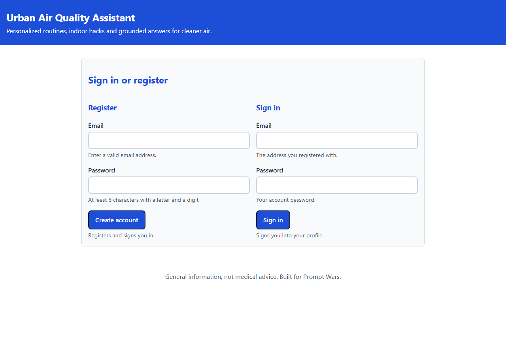
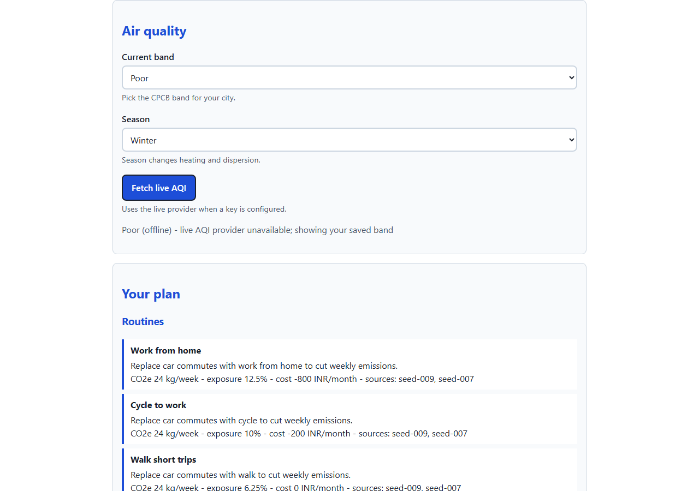
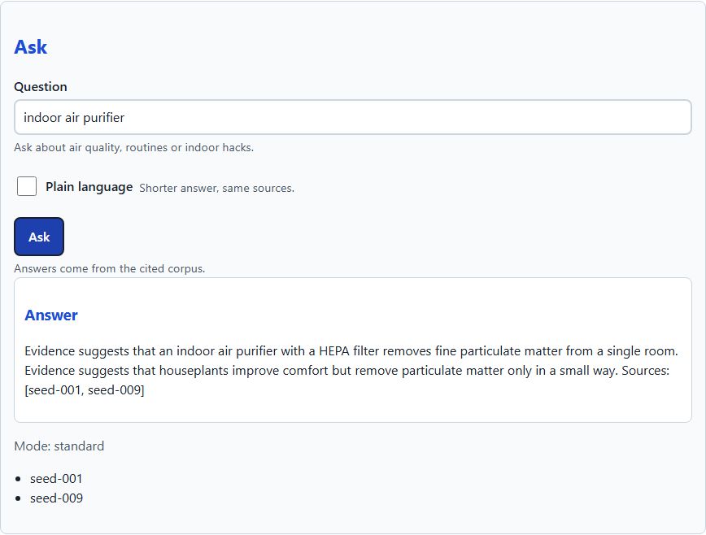

# Browser evidence

Date: 2026-11-21

- Runtime: Python 3.11.9, Node 24.11.1, npm 11.7.0.
- Browser: Playwright 1.65.1 with Chromium 1255 (Chrome for Testing
  159.0.8154.6).
- Accessibility engine: axe-core 4.14.0 via `@axe-core/playwright` 4.14.0.
- Host: Windows development machine.

## Reproduce

```bash
cd e2e
npm ci
npx playwright install chromium
npm test
```

The suite starts its own Uvicorn on `http://127.0.0.1:8901` with a fresh
SQLite database, the deterministic local LLM composer, a dummy AQI key and an
unreachable HTTP proxy. That combination makes the browser run independent of
network access: `/air` exercises the real offline fallback path and `/ask`
never calls a remote model. The temporary database is removed by the
Playwright teardown.

## Browser journey

Result: **6 passed** in 9.4 s (6 workers).

The journey spec drives the real UI through:

1. Signed-out landing page and register form.
2. Account registration.
3. Delhi profile save (children, respiratory condition, car commute, LPG).
4. Poor AQI band save and live-AQI fetch, which returns the offline fallback
   `Poor (offline) - live AQI provider unavailable; showing your saved band`.
5. Grounded question `indoor air purifier` with at least one `seed-###`
   citation.
6. Out-of-domain question `Who won the 2018 world cup?` refused with the
   corpus-boundary message and no citations.
7. PDF upload and document-library listing.
8. Sign out, followed by 401 responses from `/auth/me` and `/plans`, a
   logged-out reload, and a successful sign-in with the same credentials.

## Accessibility audit

Axe tags: `wcag2a`, `wcag2aa`, `wcag21a`, `wcag21aa`, `wcag22aa`.

| State | Audit scope | Rules evaluated | Violations |
|---|---|---|---|
| Home / login (signed out) | whole document | 23 | 0 |
| Register | `#auth-card` | 13 | 0 |
| Dashboard (AQI, grounded answer, citations, document) | whole document | 26 | 0 |
| Documents | whole document | 26 | 0 |
| Profile | whole document | 25 | 0 |
| **Total** | | | **0** |

The first successful audit run and the final run both reported zero
violations, so no accessibility remediation was required after the audit.

## Screenshots

| File | Pixels | Shows |
|---|---|---|
| `docs/screenshots/home.png` | 1280x900 | Signed-out landing page |
| `docs/screenshots/register.png` | 868x477 | Register and sign-in forms |
| `docs/screenshots/dashboard-aqi.png` | 1280x900 | Air quality panel with Poor offline AQI and plan routines |
| `docs/screenshots/grounded-answer.png` | 868x658 | Grounded answer with citation |
| `docs/screenshots/documents.png` | 868x468 | Upload form and document list |
| `docs/screenshots/mobile-dashboard.png` | 375x812 | Mobile dashboard |






